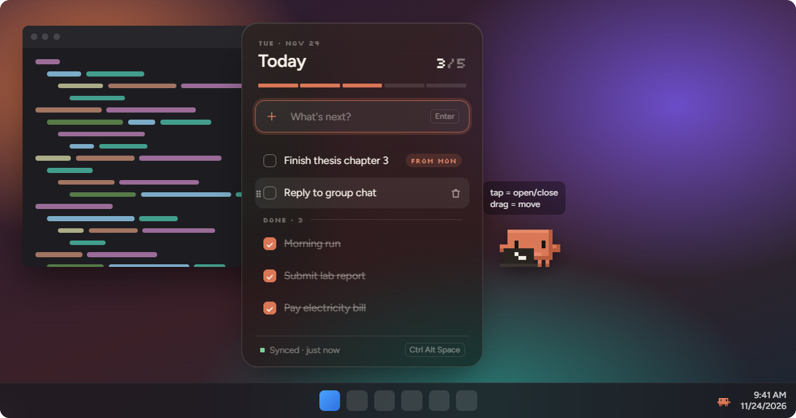

# Floating Clawd

A pixel Clawd that floats on your Windows desktop. Tap him and a glass to-do list for **today** opens beside him. The same list shows up in an Android home-screen widget, and changes sync both ways through Supabase.



## What it does

- **Clawd floats above every window.** Drag him anywhere. Clicks on the empty space around him pass through to whatever is underneath.
- **Tap him** (or press `Ctrl` `Alt` `Space`) to open today's list. Press `Esc`, click outside, or tap him again to close it.
- **Today's list:** add tasks, tick or untick them, click a title to rename it, drag the grip to reorder, use the trash icon to delete.
  - Unfinished tasks from earlier days roll over with a `FROM MON` tag.
  - Finished tasks stay under **DONE** for the rest of the day.
- **Moods:** Clawd reacts to your list.
  - He hops when you tick something off and celebrates when everything is done.
  - He types while the list is open and has coffee in the morning.
  - He gets sleepy late at night, and shows a little raindrop when he's offline.
- **Resize him:** hold `Ctrl` and scroll over Clawd, or right-click the tray icon and pick **Size**. Sizes run from Small to Extra large; he stays anchored to his bottom-right corner.
- **Works offline.** Changes are saved locally and sync when you're back online. If the laptop and phone edit the same task, the latest edit wins.
- **Tray menu:** open the list, show or hide Clawd, size, Start with Windows, sign out, quit.

The Android widget lives in a separate plan and is not built yet.

## Set up

1. **Create the backend.** Follow [`supabase/SETUP.md`](supabase/SETUP.md). It takes about five minutes: create a free project, run one SQL file, add your user, and turn off sign-ups.
2. **Configure the desktop app.** Copy `desktop/config.example.json` to `desktop/config.local.json` and paste in your project URL and **anon** key.
   - This file is git-ignored. Never put the `service_role` key in it.
3. **Run it:**

   ```sh
   cd desktop
   npm install
   npm start
   ```

   Sign in with the email and password you created in step 1.

## Build the installer

```sh
cd desktop
npm test          # unit tests (Vitest)
npm run dist      # → desktop/dist/Floating Clawd Setup <version>.exe
```

If `desktop/config.local.json` exists, it is bundled into the installer, so the installed app is ready to sign in. You can also drop a `config.local.json` into `%APPDATA%\floating-clawd\` after installing.

The installed app starts with Windows by default. Turn that off from the tray menu.

`npm run icon` regenerates `desktop/assets/icon.ico` from the sprite.

## How it's built

| Part | Tech |
|------|------|
| Backend | Supabase Postgres: row-level security, Realtime, and email + password auth |
| Desktop | Electron. The main process owns sync and the offline queue; the renderers only draw. |
| Clawd | Pixel grid rendered as SVG (`desktop/src/core/sprite.js`), with pixel-exact hit-testing |
| Panel | Plain HTML/CSS over Windows 11 acrylic, using the Figtree and Silkscreen fonts (OFL) |

- **Design:** [`design/mockup.html`](design/mockup.html)
- **Spec:** [`docs/superpowers/specs/`](docs/superpowers/specs/)
- **Plan:** [`docs/superpowers/plans/`](docs/superpowers/plans/)

Clawd here is an original pixel drawing inspired by Anthropic's mascot. This is a personal project, not affiliated with Anthropic.
